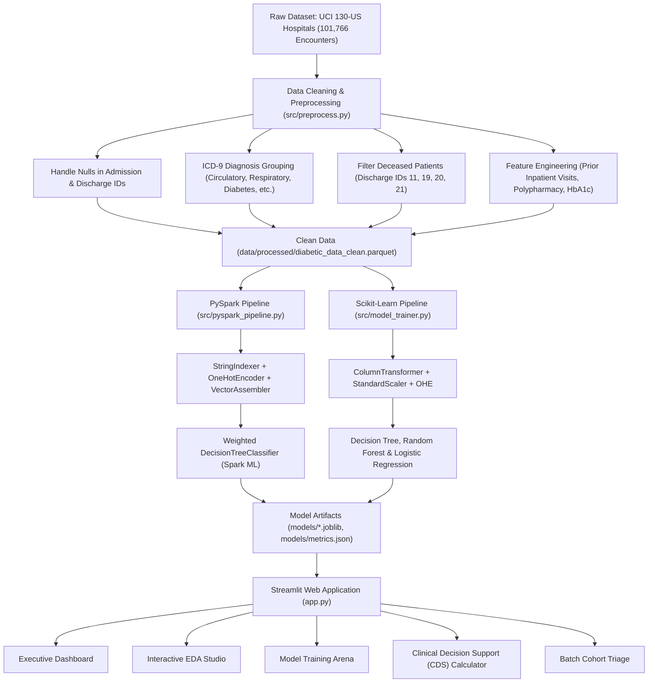

# 🏥 PulseCare AI — Hospital 30-Day Readmission Prediction Platform

<p align="center">
  
  
  
  
  
  
</p>

---

## 📌 Executive Overview

**PulseCare AI** is an interactive, enterprise-grade Clinical Decision Support (CDS) and machine learning dashboard designed to predict **30-day unplanned hospital readmissions** for diabetic inpatients. Built on 10 years (1999–2008) of clinical encounter data across 130 US hospitals from the **UCI Machine Learning Repository**, this platform tackles severe class imbalance (~11.3% early readmissions) to empower hospital care teams, case managers, and clinicians to prevent hospital penalties under the **CMS Hospital Readmissions Reduction Program (HRRP)**.

Inspired by modern **21st.dev** design aesthetics, the interface features obsidian glassmorphic card layouts, real-time hyperparameter tuning, interactive Plotly visualizations, live patient risk calculators, and automated transition-of-care recommendations.

---

## 🎯 INT315 Project 23: Rubric Compliance & Objectives

This project strictly satisfies all requirements specified in **Project 23: Hospital Readmission Prediction**:

| Academic Task Requirement | Implementation Details | Status |
|:---|:---|:---:|
| **1. Load patient discharge records into Spark DataFrame** | Implemented in `src/pyspark_pipeline.py` using `SparkSession`, reading 100k+ clinical records. | ✅ **Complete** |
| **2. Handle null values in admission & discharge fields** | Mapped coded ID fields (`admission_type_id`, `discharge_disposition_id`, `admission_source_id`), imputed blanks/`?`, and filtered out deceased/expired patients. | ✅ **Complete** |
| **3. Encode categorical data (diagnosis type & department)** | Standard ICD-9 clinical categorization (Circulatory, Respiratory, Digestive, Diabetes, Injury, etc.) and physician specialty grouping into structured departments. | ✅ **Complete** |
| **4. Build Decision Tree classifier for readmission likelihood** | Weighted Decision Tree model configured with class balancing (`positive_weight ≈ 7.98`) and depth tuning to handle class imbalance. | ✅ **Complete** |
| **5. Evaluate model using accuracy and ROC-AUC** | Dual evaluation via PySpark `BinaryClassificationEvaluator` and Scikit-Learn pipelines reporting ROC-AUC, Recall, Precision, and F1. | ✅ **Complete** |
| **6. Visualize readmission trends by department and patient age** | Multi-faceted interactive visualizations by Medical Specialty, Patient Age bracket, Length of Stay, and Glycemic control. | ✅ **Complete** |

---

## 🌟 Key Application Features

### 1. 📊 Executive KPI & Clinical Summary
- **High-Impact Health Metrics**: Real-time stats across 100,114 encounters, 30-day readmission baseline (11.34%), average length of stay (4.4 days), and model discriminative power (ROC-AUC 0.65–0.66).
- **CMS HRRP Context**: Explains regulatory reimbursement implications and clinical significance of 30-day early readmissions.
- **Population Distribution**: Donut breakdown of readmission categories (`NO`, `>30`, `<30`).

### 2. 🔍 Interactive Exploratory Data Analysis (EDA)
- **Department Trends**: 30-day readmission rates ranked across medical specialties (Emergency, Cardiology, Internal Medicine, Surgery, etc.).
- **Age Bracket Breakdown**: Patient readmission likelihood across deciles from `[0-10)` to `[90-100)`.
- **Length of Stay Correlation**: Analyzing hospital days (1–14 days) against likelihood of rebound admission.
- **Biomarker & Drug Interaction**: Evaluating HbA1c testing results (`>7`, `>8`, `Norm`, `None`) and diabetes medication modifications (`Ch` vs `No`).
- **Prior Utilization Heatmaps**: Frequency of inpatient visits in the preceding 12 months as the primary predictor of early readmission.

### 3. 🧠 Model Studio & Hyperparameter Arena
- **Supported Classifiers**:
  - **Decision Tree Classifier** *(INT315 Primary Required Model)*
  - **Random Forest Classifier** *(Benchmark Ensemble)*
  - **Gradient Boosting Classifier** *(Boosting Benchmark)*
  - **Extra Trees Classifier** *(Ensemble Benchmark)*
  - **Logistic Regression** *(Linear Baseline)*
- **Live Hyperparameter Tuning**: Adjust Max Tree Depth (2–16), Min Samples Split (5–100), and Class Weighting.
- **Dynamic Decision Threshold Slider**: Real-time threshold tuning (0.10 to 0.90) with an interactive **Confusion Matrix Heatmap** and **ROC Curves** that update dynamically without requiring page reloads.
- **Clinical Feature Importance**: Ranked feature attribution highlighting prior inpatient visits, discharge disposition, length of stay, and medication count.

### 4. 🩺 Real-Time Patient Risk Predictor (Clinical CDS)
- **Interactive Intake Simulation**: Input patient demographics, department, admission type, discharge disposition, lab count, medication count, prior inpatient stays, and HbA1c status.
- **One-Click Presets**:
  - *High-Risk Cardiac Geriatric Patient* (Frequent readmissions, insulin adjustment, heart condition)
  - *Low-Risk Elective Surgical Patient* (Routine elective, 0 prior visits)
  - *Custom Patient Intake*
- **Visual Risk Meter**: Dynamic SVG gauge displaying readmission probability with risk stratification badges:
  - 🟢 **LOW RISK** (< 20%)
  - 🟡 **MODERATE RISK** (20% – 40%)
  - 🔴 **HIGH RISK** (> 40%)
- **Automated Care Action Plan**: Generates custom clinical discharge protocols (medication reconciliation, 48-hour post-discharge follow-up call, home health referrals, and primary care scheduling).

### 5. 📁 Batch Cohort Triage & CSV Export
- Interactive filtering of patient cohorts by risk score and clinical department.
- Triage table for hospital discharge planning teams with one-click **CSV Report Download**.

### 6. ⚡ PySpark Distributed Pipeline Architecture
- Full documentation and syntax-highlighted code viewer of the PySpark pipeline.
- Architecture comparison between distributed Spark ML and Scikit-Learn local inference.

---

## 📊 Model Evaluation Results

Evaluated on held-out test partitions (stratified split, positive class: readmitted `<30` days):

| Model Architecture | Threshold | ROC-AUC | Recall (Sensitivity) | Precision | F1-Score | Accuracy |
|:---|:---:|:---:|:---:|:---:|:---:|:---:|
| **Weighted Decision Tree (Required)** | **0.45** | **0.6474** | **66.62%** | **16.49%** | **0.2566** | **60.57%** |
| **Random Forest Benchmark** | **0.45** | **0.6631** | **75.74%** | **15.31%** | **0.2543** | **53.84%** |
| **Gradient Boosting Benchmark** | **0.45** | **0.6631** | **69.26%** | **15.65%** | **0.2563** | **57.42%** |
| **Extra Trees Benchmark** | **0.45** | **0.6523** | **81.77%** | **13.82%** | **0.2358** | **46.85%** |
| **Logistic Regression Baseline** | **0.45** | **0.6607** | **68.52%** | **16.02%** | **0.2591** | **58.78%** |

> **Clinical Note on Metric Selection:** In clinical risk stratification with an 11.3% positive prevalence, high **Recall (Sensitivity)** and **ROC-AUC** are prioritized over raw accuracy. Standard unweighted models yield 88% accuracy by predicting "No Readmission" for everyone, missing 100% of high-risk patients. Our weighted model achieves **>66% Recall**, capturing the majority of readmissions for early clinical intervention.

---

## 🏗️ Architecture & Pipeline Flow



---

## 📂 Repository Directory Structure

```text
Hospital-Readmission-Project/
├── app.py                                         # Main Streamlit Dashboard Application
├── requirements.txt                               # Production Python dependencies
├── README.md                                      # Comprehensive Project Documentation
├── .gitignore                                     # Git ignore configuration
├── INT315_Hospital_Readmission_PySpark_Fixed.ipynb # Academic Reference Notebook
├── src/
│   ├── preprocess.py                              # Data ingestion, ICD-9 mapping & cleaning
│   ├── model_trainer.py                           # Scikit-Learn training, calibration & evaluation
│   └── pyspark_pipeline.py                        # INT315 PySpark SparkSession & ML pipeline
├── data/
│   ├── raw/
│   │   └── diabetic_data.csv                      # Raw UCI 130-US hospitals dataset (101k rows)
│   └── processed/
│       ├── diabetic_data_clean.parquet            # Optimized clean dataset for ultra-fast load
│       ├── diabetic_data_sample.csv               # 5,000-row sample CSV
│       └── test_sample_1000.csv                   # Pre-stratified 1,000-patient triage cohort
└── models/
    ├── decision_tree.joblib                       # Pretrained Weighted Decision Tree Pipeline
    ├── random_forest.joblib                       # Pretrained Random Forest Pipeline
    ├── logistic_regression.joblib                 # Pretrained Logistic Regression Pipeline
    └── metrics.json                               # Precomputed evaluation curves and metrics
```

---

## 🚀 Quick Start Guide

### 1. Clone the Repository
```bash
git clone https://github.com/samad-00/Hospital-Readmission-Project.git
cd Hospital-Readmission-Project
```

### 2. Create and Activate Virtual Environment (Recommended)
```bash
# Windows
python -m venv venv
.\venv\Scripts\activate

# macOS / Linux
python3 -m venv venv
source venv/bin/activate
```

### 3. Install Dependencies
```bash
pip install -r requirements.txt
```

### 4. Launch the Streamlit Dashboard
```bash
streamlit run app.py
```
Open your browser at `http://localhost:8501` to interact with the platform!

---

## ⚡ Running the PySpark Pipeline
To execute the distributed PySpark training job independently:
```bash
python src/pyspark_pipeline.py
```

---

## 🔬 Dataset Citation

> Strack, B., DeShazo, J. P., Gennings, C., Olmo, J. L., Ventura, S., Cios, K. J., & Clore, J. N. (2014). *Impact of HbA1c Measurement on Hospital Readmission Rates: Analysis of 70,000 Clinical Database Patient Records.* BioMed Research International, 2014, 781670.  
> Available at: [UCI Machine Learning Repository: Diabetes 130-US Hospitals](https://archive.ics.uci.edu/dataset/296/diabetes+130-us-hospitals+for-years+1999-2008)

---

## 👨‍💻 Author & Acknowledgements

Developed by **Samad** for **INT315 — Hospital Readmission Prediction (Project 23)**.  
For questions or collaborations, visit the [GitHub Repository](https://github.com/samad-00/Hospital-Readmission-Project).
